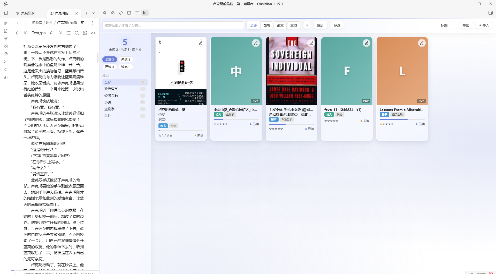
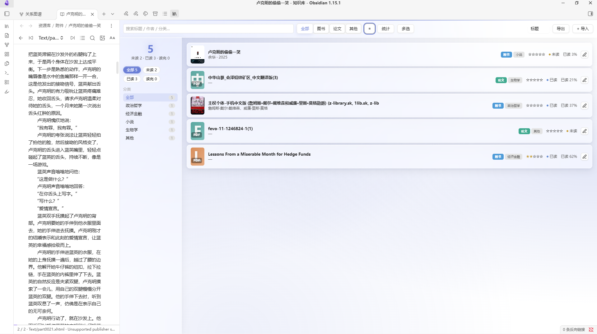
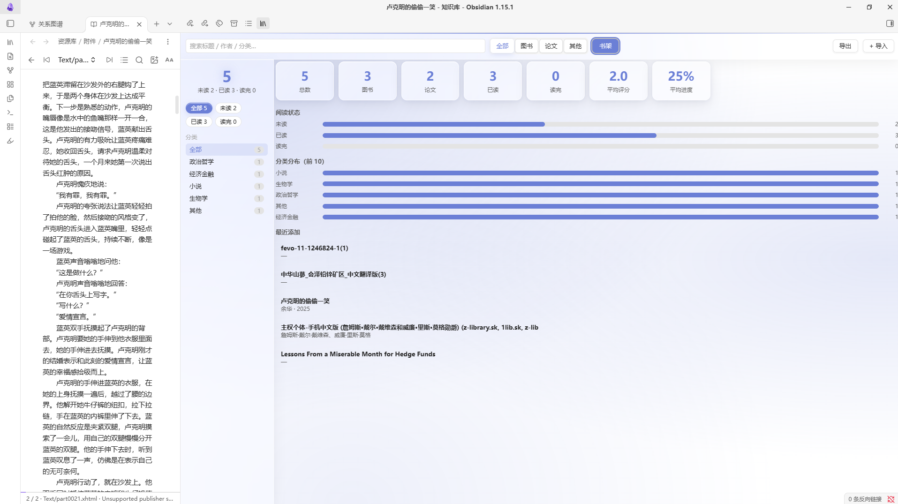
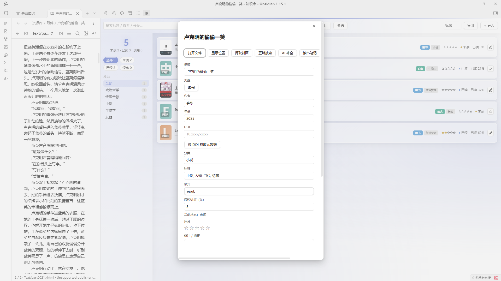

# 资料库 Library（obsidian-library）

一个嵌在 [Obsidian](https://obsidian.md) 里的「电子书 + 论文」收纳与写作助手。

多格式导入、分类管理、阅读进度续读、引用生成、统计面板、批量操作，以及论文写作辅助，一站式搞定。

---

## ✨ 功能特性

- **多格式导入**：PDF / EPUB / MOBI / AZW3 / FB2 / DJVU / TXT / CBZ / CBR，拖拽或选择导入；支持扫描库内已有文件、BibTeX / RIS 文献批量导入
- **分类管理**：分类、标签、评分；状态（未读 / 已读 / 读完）按阅读进度自动判断
- **两种视图**：网格 / 列表切换，搜索高亮、类型 / 分类 / 状态筛选、多字段排序
- **封面**：PDF / EPUB 自动提取封面，豆瓣搜索下载封面
- **元数据补全**（无需翻墙）：DOI → Crossref、豆瓣搜索（评分 + 简介）、DeepSeek AI 补全
- **阅读**：PDF 在 Obsidian 内打开、自动续读、进度条；EPUB 走 Obsidian 阅读插件
- **读书笔记**：书 / 论文两套笔记模板
- **引用**：一键复制 GB/T 7714 / APA / BibTeX；右键快捷菜单
- **统计面板**：阅读状态、分类分布、评分、最近添加
- **批量操作**：多选后批量标记 / 设置分类 / 删除 / 导出引用
- **导出备份**：Markdown / CSV / BibTeX / JSON
- **论文写作**：插入引用、自动生成参考文献、论文模板、文献阅读总结模板、AI 润色 / 扩写 / 改写 / 翻译

---

## 📷 截图

| 网格视图 | 列表视图 |
| --- | --- |
|  |  |

| 统计面板 | 编辑弹窗 |
| --- | --- |
|  |  |

---

## 🚀 安装

### 方式一：手动安装（推荐）

1. 下载本仓库的 `main.js`、`manifest.json`、`styles.css`
2. 放进你的库目录：`<你的库>/.obsidian/plugins/obsidian-library/`
3. Obsidian → 设置 → 第三方插件 → 关闭限制模式 → 启用「资料库 Library」

### 方式二：等待上架社区市场（规划中）

---

## 🧭 快速开始

1. 点左侧丝带栏 📚 图标（或 `Ctrl+P` 搜「打开资料库」）
2. 点工具栏「**+ 导入**」→「导入文件」或「扫描已有文件」
3. 点卡片直接阅读，悬停点 ✎ 编辑元数据

完整使用说明见 **[使用说明.md](./使用说明.md)**。

---

## 📁 目录结构

```
obsidian-library/
├── main.js          # 插件主代码
├── manifest.json    # 插件清单
├── styles.css       # 样式（玻璃质感 + 类型主题色）
├── README.md        # 本文件
└── 使用说明.md       # 详细使用文档
```

---

## ⚙️ AI 功能（可选）

AI 补全 / AI 写作使用 DeepSeek（OpenAI 兼容接口），需在插件设置里填 API Key（platform.deepseek.com 免费注册）。也可换成 OpenAI / Kimi / 本地 Ollama 等。

---

## 📄 许可

[MIT](./LICENSE)
